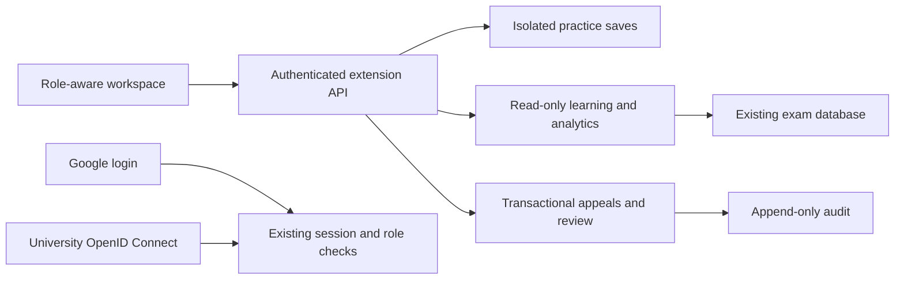

# Assessment platform expansion

## Boundaries and compatibility

The existing exam lifecycle remains authoritative: entry, deadlines, answer versions, warning policy, submission and grading continue through the current services. New features use an additive migration and a separate extension service mounted under `/api/platform/growth`. Existing credentials login stays available. Normal Google login was added after the user selected it as the preferred sign-in option. No existing table or data is dropped. A source snapshot is stored locally in `.data/backups/before-expansion.tar.gz`.

## Features

1. **Readiness/practice:** Separate per-user practice storage with monotonic versions and an explicit save/read-back check. Uses synthetic questions, never unreleased exam content, never an official attempt or grade. Browser camera/microphone checks require a click, stop media tracks, and report actual failures. Connectivity is measured against the authenticated API. Results are advisory and timestamped.
2. **Action center:** Instructor-scoped pending check-ins, active attempts with stale heartbeats, unreviewed warning events, and pending appeals. Approvals reuse existing check-in authorization. Event reviews are durable and audited. Stale heartbeat means connection needs attention, not misconduct.
3. **Learning:** Students see only their completed attempts for exams with released results. Normalize scores against available marks; separate pending grading from zero. Group marked answers by topic and include instructor feedback. Practice is excluded.
4. **Analytics:** Teachers see only their courses. Aggregate completed, graded responses, sample size, average credit, blank rate and option distributions. Low average credit suggests review, not that a question is defective. Small samples are labeled. Practice is excluded.
5. **Sign-in integrations:** Optional environment-configured OpenID Connect using discovery, PKCE/state/nonce and issuer/subject mappings explicitly assigned by an administrator. Custom OIDC requires explicit issuer/subject mapping. Google can provision verified Workspace accounts only for configured domains; those users start as students, except exact teacher emails explicitly allowlisted by an administrator. Existing roles are preserved, Google never creates admins, and local OTP requirements remain in force.
6. **Appeals:** Student selects their own recorded warning, submits explanation; owner instructor/admin reviews and records a reasoned decision. Version checks prevent overwriting concurrent decisions. Timeline preserves prior decisions and one student reopening request. Decisions do not silently change marks, warnings or attempts; existing instructor controls remain explicit.

## Data and authorization

Migration 005 adds practice_sessions, incident_reviews, appeals, appeal_messages, sso_identities and legacy LMS tables. The LMS tables remain unused for compatibility with databases where the migration has already run. References point to existing users/exams/events. All extension requests pass existing origin, session-version and rate-limit checks. Mutations use strict schemas and transactions. Student evidence responses expose event type/time/severity, not private instructor metadata.

## API boundaries

All routes below are relative to `/api/platform/growth`:

| Route | Access | Purpose |
| --- | --- | --- |
| GET/POST practice | Signed-in user, own records | Read/write synthetic practice answer with monotonic version |
| GET actions; POST actions | Owner instructor/admin | Support queue and durable warning review |
| GET learning | Student, own records | Released results, feedback and topic aggregates |
| GET analytics | Owner instructor/admin | Completed-response statistics |
| GET/POST appeals; POST appeals/:id/update | Student owner or course instructor/admin | Explanation, review, decision and one reopening |
| GET integrations; POST integrations/identity | Admin | Sign-in provider status and custom OIDC identity mappings |

PostgreSQL row locks protect appeal versions; unique constraints protect provider subjects and incident reviews.

## Rollout and validation

Apply the additive migration before serving new code. Build/typecheck/lint; run existing domain/lifecycle tests plus extension isolation, ownership, concurrent version and identity mapping tests. Browser checks cover new navigation and forms. Real SSO acceptance requires the institution's configured provider. For rollback, restore prior source/build; additive tables can remain, preserving new records.
